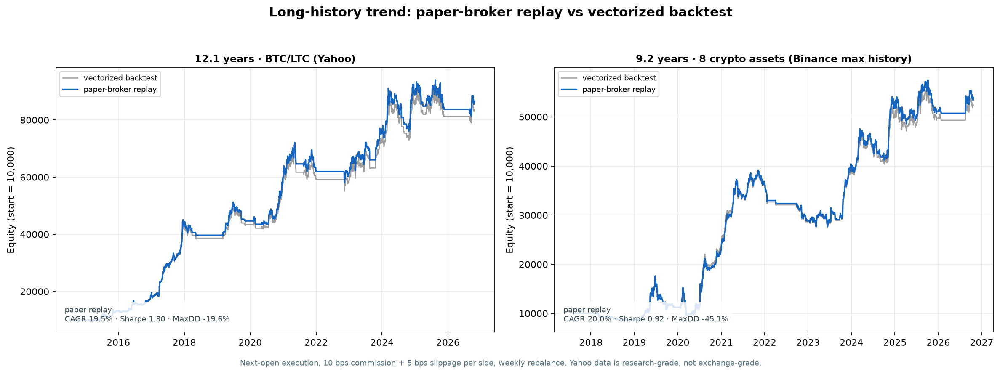

# 13 — Long-History Paper-Broker Backtest

**Date:** 23 October 2026  
**Question:** run the paper-trading replay on as close to 10 years of data as possible.



---

## 1. Data reality

A **10-year, 8-asset crypto universe does not exist** on free exchange data:

- Binance BTCUSDT starts **2017-08-17**.
- SOLUSDT, DOGEUSDT, and LINKUSDT start later; a 5+ asset cross-section only exists from 2020.
- Yahoo Finance has BTC-USD and LTC-USD from **2014-09-17**, which gives a genuine **12.1-year** history for a 2-asset trend test.

So I ran two honest tests:

| Test | Universe | Period | Length | Source |
|---|---|---|---:|---|
| **True 10+ year** | BTC, LTC | 2014-09-17 → 2026-10-21 | **12.1 years** | Yahoo Finance |
| **Max available 8-asset** | BTC, ETH, BNB, SOL, XRP, ADA, DOGE, LINK | 2017-08-17 → 2026-10-22 | **9.2 years** | Binance |

Yahoo is research-grade, not exchange-grade. The 8-asset test is the more realistic universe, but it is **not** a full 10 years.

---

## 2. True 10+ year test — BTC/LTC trend

Period: **2014-09-17 → 2026-10-21** · 8,836 bars · 0 OHLC violations.

| Metric | Vectorized backtest | Paper-broker replay |
|---|---:|---:|
| Final equity | $83,738.46 | **$86,530.46** |
| CAGR | 19.19% | **19.52%** |
| Volatility | 14.38% | 14.56% |
| Sharpe | 1.292 | **1.297** |
| Sortino | 1.524 | 1.534 |
| Max drawdown | −20.65% | **−19.59%** |
| Annual turnover | 2.66× | 2.83× |
| Fills | — | 684 |

The execution replay matches the backtest closely: final equity differs by ~3.3%, CAGR by 0.33 pp, and max drawdown by ~1.1 pp.

### Walk-forward (8 folds, 1-year OOS each)

| Trials | OOS CAGR | OOS Sharpe | OOS Max DD | DSR | PBO |
|---:|---:|---:|---:|---:|---:|
| 192 | 4.59% | **0.437** | −19.32% | **0.000** | **0.463** |

This is the important caveat. The full-sample 12-year result looks excellent, but the walk-forward OOS Sharpe is only ~0.44 and PBO is ~0.46. The full-sample number is partly regime/parameter luck, not a stable edge.

---

## 3. Max available 8-asset test — Binance

Period: **2017-08-17 → 2026-10-22** · 23,954 bars · 8 assets · 0 OHLC violations.

The 8-asset panel starts in 2017 with BTC/ETH/BNB; other assets join later. The trend strategy uses each asset when it has enough history. XSMOM would only have 5+ assets from 2020.

| Metric | Vectorized backtest | Paper-broker replay |
|---|---:|---:|
| Final equity | $52,435.24 | **$53,470.31** |
| CAGR | 19.76% | **20.02%** |
| Volatility | 23.01% | 22.74% |
| Sharpe | 0.898 | **0.916** |
| Sortino | 0.943 | 0.974 |
| Max drawdown | −47.43% | **−45.13%** |
| Annual turnover | 3.92× | 4.16× |
| Fills | — | 1,610 |

The replay tracks the backtest within ~2% final equity. The much larger drawdown (−45% vs −20%) is what happens when you include 2018 and 2022, not just the 2020–2026 bull period.

### Walk-forward (6 folds, 1-year OOS each)

| Trials | OOS CAGR | OOS Sharpe | OOS Max DD | DSR | PBO |
|---:|---:|---:|---:|---:|---:|
| 144 | 12.13% | **0.978** | −22.53% | **0.0006** | **0.142** |

PBO improves to ~0.14, which is encouraging, but the DSR is still ~0 after accounting for 144 trials. The evidence is **not strong enough** to call this a validated edge.

---

## 4. What this changes

1. **The execution layer is consistent.** Trend replay vs backtest differs by ~2–3% final equity over 9–12 years. That validates order planning, paper fills, cash accounting, and compounding.
2. **The 12-year full-sample Sharpe is misleading.** OOS Sharpe drops to ~0.44 with PBO ~0.46. A good-looking long backtest is not a proven strategy.
3. **The 8-asset test is more realistic.** It includes 2018 and 2022 and shows a −45% to −47% max drawdown. That is the risk you would actually take.
4. **Multiple-testing still matters.** Even the better 8-asset OOS result has DSR ≈ 0 after 144 trials.
5. **A 10-year 8-asset crypto universe is not available for free.** Do not let anyone sell you a “10-year backtest” on assets that did not exist.

---

## 5. Reproduce

```powershell
# True 10+ year BTC/LTC (Yahoo)
uv run python -m tradingbot --config config/long_history.yaml download
uv run python -m tradingbot --config config/long_history.yaml backtest --strategy trend
uv run python -m tradingbot --config config/long_history.yaml paper-replay --strategy trend
uv run python -m tradingbot --config config/long_history.yaml walkforward --strategy trend

# Max available 8-asset (Binance)
uv run python -m tradingbot --config config/max_history.yaml download
uv run python -m tradingbot --config config/max_history.yaml backtest --strategy trend
uv run python -m tradingbot --config config/max_history.yaml paper-replay --strategy trend
uv run python -m tradingbot --config config/max_history.yaml walkforward --strategy trend

# Chart
uv run python scripts/draw_long_history.py
```

Artifacts:
- `artifacts/long_history/`
- `artifacts/max_history/`
- `docs/long_history.png`

---

## 6. Verdict

- **Execution path:** validated in paper across 12 years and 9 years, including 1,610 fills on the 8-asset test.
- **Strategy:** not validated for live capital. The true 10-year test has weak OOS/PBO; the 8-asset test has better PBO but DSR near zero and a −45% drawdown.
- **Next research step:** add delisted assets, funding/carry, and a macro regime overlay; then re-run walk-forward on a longer, broader universe.

Do not trade real money from these results.
