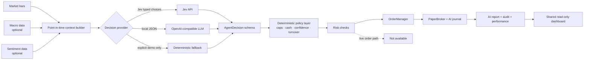

# 16 — Separate AI-Agent Paper Pipeline

**Status:** built and running as a separate paper account. Jev is configured and returned real typed decisions in 10 historical dry runs; the clean AI paper account started at $10,000 on 23 Oct 2026. It is not connected to the deterministic campaign, has no broker credentials, and cannot place live orders.

---

## 1. Why a separate pipeline

The deterministic trend/XSMOM campaign remains the evidence baseline. The AI pipeline is an experimental sleeve with a different failure mode, a different decision process, and its own accounting. Mixing them would contaminate the original paper track record and make attribution impossible.

| Item | Deterministic campaign | AI-agent pipeline |
|---|---|---|
| Config | `config/base.yaml`, `config/xsmom.yaml` | `config/ai_agent.yaml` |
| Decision | fixed rules | AI provider + deterministic policy |
| Paper state | `artifacts/paper_state.json`, `artifacts/order_state_*.sqlite` | `artifacts/ai/paper_state.json`, `artifacts/ai/order_state.sqlite` |
| Journal | `artifacts/orders.sqlite` | `artifacts/ai/orders.sqlite` |
| Performance | `artifacts/performance_*.jsonl` | `artifacts/ai/performance.jsonl` |
| Heartbeat | `artifacts/heartbeat.json` | `artifacts/ai/heartbeat.json` |
| Kill switch | `artifacts/KILL` | `artifacts/ai/KILL` |
| Reports | `artifacts/reports/evaluation_*.md` | `artifacts/ai/reports/latest.md` |
| Scheduler | `TradingBotPaperCampaign` at 07:00 | run manually or add a separate task |
| Live allowed | gated, not approved | **no live path** |

The only shared inputs are read-only market data and code.

---

## 2. Architecture



The AI provider is the **decision maker** in this sleeve. The policy layer is not a co-strategist: it is a hard constraints filter. It can clip, scale, or reject a decision, and it can force a hold when confidence is too low. The broker is paper-only.

---

## 3. Decision flow

1. Load only completed daily bars.
2. Build a point-in-time context: returns, moving averages, volatility, drawdown, volume, breadth, optional macro and sentiment.
3. Send the context to one provider:
   - **Jev**: per-asset `long` / `flat` / `short` choices and a market-regime choice.
   - **OpenAI-compatible LLM**: a JSON object with actions or target weights.
   - **deterministic fallback**: explicitly labelled, only for demo/testing.
4. Validate the provider output against a typed schema.
5. Apply the deterministic policy:
   - confidence floor
   - long-only unless explicitly enabled
   - per-asset cap
   - gross cap
   - minimum cash
   - one-way turnover cap
   - regime-based gross reduction
   - inverse-vol sizing for discrete actions
6. Run `assert_safe` and the kill-switch check.
7. Plan orders with deterministic client IDs, execute through the paper broker, persist state and journal.
8. Write an audit record, a report, a heartbeat, and a performance point.

No model output is allowed to skip steps 5–7.

---

## 4. Decision contract

```json
{
  "regime": "risk_on | neutral | risk_off",
  "confidence": 0.0,
  "actions": [
    {
      "asset": "BTCUSDT",
      "action": "long | flat | short",
      "confidence": 0.0,
      "reason": "short text"
    }
  ],
  "target_weights": {"BTCUSDT": 0.0},
  "notes": "short text"
}
```

Use actions **or** target weights. The policy layer rejects unknown assets, duplicate actions, non-finite values, and decisions that contain neither form.

---

## 5. Providers

### Jev (optional, hosted, paid)

```yaml
agent:
  provider: jev
  model: jev-latest
  endpoint: https://api.typesafe.ai/v1/systemone
  api_key_env: TYPESAFE_API_KEY
```

Jev returns typed answers with probabilities/confidence. It does not generate prose and does not call tools. See `docs/17_JEV_EVALUATION.md`.

### Local or hosted OpenAI-compatible model

```yaml
agent:
  provider: openai_compatible
  endpoint: http://localhost:11434/v1/chat/completions
  model: qwen2.5:7b
  api_key_env: AI_API_KEY
```

Works with Ollama, LM Studio, vLLM, or a hosted compatible endpoint. The model must return the JSON contract above.

### Deterministic fallback

```powershell
uv run python -m tradingbot --config config/ai_agent.yaml ai-run --dry-run --provider deterministic
```

This is **not AI**. It exists for wiring tests and demos, and the report/audit marks it as a fallback.

The default config is `fallback: none`: an AI outage holds existing positions and reports an error rather than silently switching strategy.

---

## 6. Run it

```powershell
# Set a provider key if using Jev
$env:TYPESAFE_API_KEY = "..."

# One AI paper cycle
uv run python -m tradingbot --config config/ai_agent.yaml ai-run

# Decision only, no orders
uv run python -m tradingbot --config config/ai_agent.yaml ai-run --dry-run

# Scorecard (paper performance, fallback rate, TCA, calibration)
uv run python -m tradingbot --config config/ai_agent.yaml ai-evaluate

# Ten point-in-time dry decisions through the selected provider
uv run python scripts/jev_smoke.py

# Fresh AI account
uv run python -m tradingbot --config config/ai_agent.yaml ai-run --reset

# Wrapper with logs
powershell -ExecutionPolicy Bypass -File scripts/run_ai_pipeline.ps1
powershell -ExecutionPolicy Bypass -File scripts/run_ai_pipeline.ps1 -DryRun

# Optional separate daily task at 07:15, after configuring a provider
powershell -ExecutionPolicy Bypass -File scripts/register_ai_campaign.ps1
```

The deterministic campaign is unchanged:

```powershell
powershell -ExecutionPolicy Bypass -File scripts/run_campaign.ps1 -Reset
```

---

## 7. Dashboard

`uv run streamlit run src/tradingbot/ops/dashboard.py`

The sidebar has three views:

- **Both** — side-by-side equity and status for deterministic trend, deterministic XSMOM, and the AI-agent paper account.
- **Deterministic** — the original TCA/drift/live-vs-backtest view.
- **AI agent** — AI equity, provider/model, fallback warning, confidence, regime, target weights, policy notes, positions, orders, audit path, and the raw decision.

All views are read-only. The dashboard has no order controls and no config mutation.

---

## 8. Safety boundaries

- `agent.paper_only: true` refuses any broker other than `paper`.
- The AI pipeline does not import the live broker factory.
- No exchange/API keys are sent to the model.
- The model sees market features and paper positions only.
- Every decision has an audit file with request/response/policy/orders.
- Provider failure fails closed.
- The kill switch is `artifacts/ai/KILL`.
- Deterministic order IDs make reruns idempotent.
- `OrderManager` still reconciles startup state and refuses blind resubmission.

---

## 9. Eight-agent squad

The AI lane now has an optional separate eight-agent paper account:

`macro -> trend -> breakout -> XSMOM -> sentiment -> risk -> execution -> chair`

Every specialist is a role-scoped Jev typed call. Each writes a memo to a
shared blackboard, and the chair receives all seven prior memos. The squad still
passes through this pipeline's deterministic policy and risk checks; risk
vetoes and execution blocks are enforced by code. It is deliberately separate
from the single-provider Jev account so the designs can be compared. See
`docs/24_AI_SQUAD.md` and `config/ai_squad.yaml`.

---

## 10. What is deliberately not here

- No autonomous web browsing or shell access for the trading model.
- No live execution.
- No training on paper history.
- No automatic promotion from AI paper to live.
- The hard gate (`live-gate`) treats AI live execution as not implemented, so it cannot return GO for this lane.
- No claim that Jev or an LLM has an edge. That is an empirical question.
- No real X feed. `data/normalized/sentiment.parquet` is the pluggable input; without it, sentiment is marked unavailable.

---

## 10. Verification

- `uv run pytest -q` — **89 passing**
- `uv run ruff check src scripts tests`
- `uv run mypy src`
- Dashboard renders both pipelines and the AI view with no console errors.
- Demo mode with the deterministic fallback is clearly labelled and is not presented as an AI result.

See `docs/17_JEV_EVALUATION.md` for the Jev-specific assessment.
