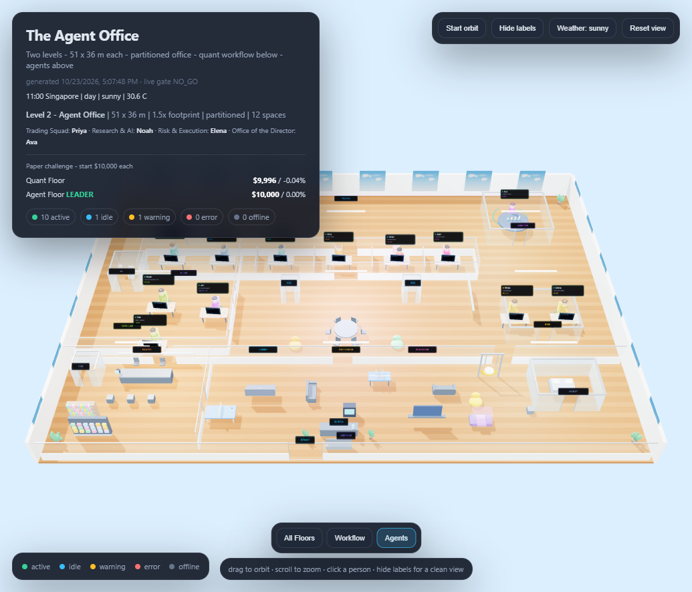

# 20 — Two-Floor Agent Office



**Status:** local, read-only visualization. No order controls.

---

## 1. Two floors, two teams

The scene is deliberately split into two levels:

| Level | Team | Contents |
|---|---|---|
| **1 — Quant Workflow** | Deterministic | Data Lake, Feature Lab, Backtest Grid, Risk Vault, Meta Table, Execution Gateway, Evaluation, Quant Meeting, Quant Pantry, Quant Fun |
| **2 — Agent Office** | Agent | Trading Bullpen, AI Lab, Data Lab, Discussion, Meeting, Director, Risk, Guest, Pantry, Entertainment, Lobby, WC, Reception, Phone booths, Store |

Each floor is **51 × 36 m** (1.5× the original 34 × 24 m footprint). This is the 40% reduction from the earlier 85 × 60 m pass.

The **Quant Workflow** floor has no people. It shows the machinery of the original pipeline: data, features, validation, risk, allocation, execution, evaluation.

The **Agent Office** floor has the people: Priya, Maya, Leo, Nina, Omar, Noah, Jev, Kai, Elena, Rhea, Sam, Ava.

Both floors have their own meeting room, pantry, and recreation space.

### Partitioned layout

The agent floor is no longer one open room:

- glazed, framed trading bullpen with cubicle dividers
- separate AI/Data lab
- enclosed meeting, director, risk, guest, and WC rooms
- pantry and front lounge with a framed corridor
- glazed entrance, reception desk, two phone booths, and a small store room
- solid lower wall panels with glass upper panels, plus door openings and frames

The quant floor keeps the machine hall, but separates the back lab from the corridor and front amenities.

---

## 2. Competition

The HUD shows a paper challenge between the two floors:

```text
Quant Floor     $9,996   -0.04%
Agent Floor    $10,000    0.00%  LEADER
```

- Quant Floor = deterministic meta-allocator paper account.
- Agent Floor = Jev AI paper account.
- Both start at $10,000.
- The winner is the higher paper return.
- `LEADER` is shown in the HUD.

There is no transfer of capital between floors. The visual scoreboard is read-only.
It does not change allocation, risk, or execution.

---

## 3. Daylight, night, rain

The office uses **Singapore time** (`Asia/Singapore`):

- **Day:** warm sun, bright sky, strong shadows.
- **Dawn/dusk:** orange sky, softer light.
- **Night:** dark sky, stars, artificial interior lights.
- **Weather:** sunny, cloudy, or rain; rain adds gray skies and window streaks.

Weather is fetched from the free **Open-Meteo** API for Singapore when available.
If the network is unavailable, a deterministic local fallback is used.

Controls:

- `Weather: Auto` — cycle sunny / cloudy / rain manually.
- URL override for screenshots: `?hour=22&weather=rain`

The scene updates the phase every minute.

---

## 4. Amenities and play

- Full-height windows and natural light
- Wood floor, rugs, plants, warm furniture, colorful chairs
- Table tennis, foosball, bean bags, swing chair, nap pod, arcade
- Snack wall, coffee counter, bookshelf
- Meeting tables and closed/frosted rooms
- Idle agents wander between waypoints; active agents stay at their desks

---

## 5. Squads and managers

| Squad | Manager | Members |
|---|---|---|
| Trading | **Priya** — Head of Trading | Maya (Trend), Leo (XSMOM), Nina (Breakout), Omar (Reversal) |
| Research & AI | **Noah** — Head of Research & AI | Jev (AI), Kai (Data) |
| Risk & Execution | **Elena** — Chief Risk Officer | Rhea (Risk), Sam (Execution) |
| Office of the Director | **Ava** — Portfolio Director | Meta allocator |

Clicking a person shows squad, manager, floor, status, equity, return, and task description.

---

## 6. Data and safety

- Statuses come from evaluation reports, AI reports, heartbeats, and the live gate.
- The scene is read-only. No broker calls, no order controls.
- Three.js and OrbitControls are vendored locally in `web/vendor/`.
- No external 3D service or telemetry is used.
- Open-Meteo is the only optional external call, for Singapore weather.

---

## 7. Blender / MCP

**Connected and verified on this machine:**

- Blender 4.5.10 LTS installed
- MCP for Blender add-on installed at:
  `C:\Users\chin_\AppData\Roaming\Blender Foundation\Blender\4.5\scripts\addons\blender_mcp.py`
- Blender MCP server running on `localhost:9876`
- OpenCode MCP server `blender` connected
- Verified with `get_addon_status` and `get_scene_info`

The current office is still procedural Three.js geometry. Blender MCP is available
for future detailed furniture/character modeling and `.glb` export. It is **not**
in the trading or order path.

Restart the local bridge after closing Blender:

```powershell
powershell -ExecutionPolicy Bypass -File scripts/start_blender_mcp.ps1
```

---

## 8. Build / open

```powershell
uv run python scripts/build_office3d.py
powershell -ExecutionPolicy Bypass -File scripts/run_dashboard.ps1
```

Open `artifacts/office3d/office.html`, or use dashboard → **3D Office**.

---

## 9. Limitations

- Stylized low-poly people, not rigged characters.
- No collision/navmesh pathfinding; agents follow authored waypoints.
- The office is a visualization; it does not drive trading.
- The competition scoreboard is paper-only and read-only.
- Blender is connected but the office is not yet a Blender asset.
