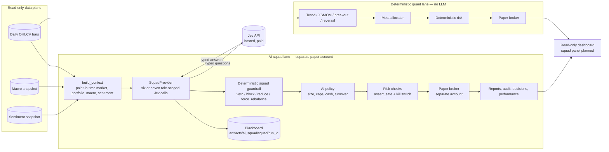
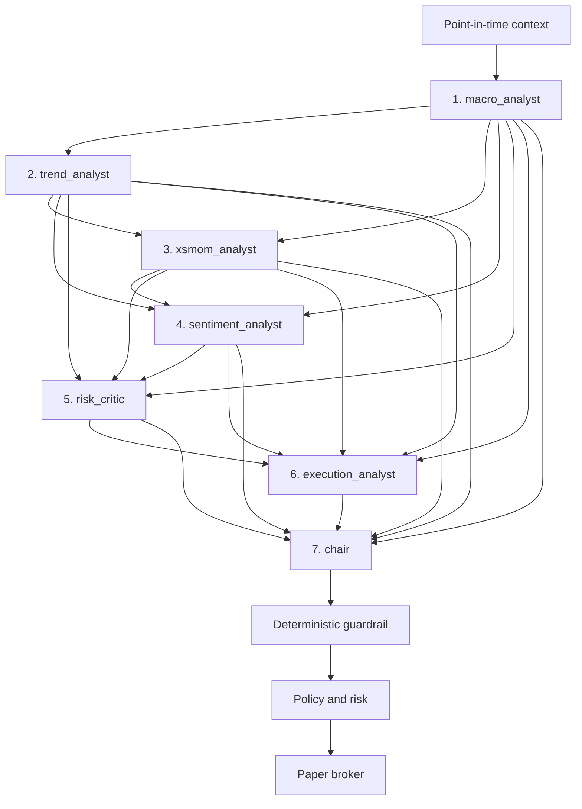
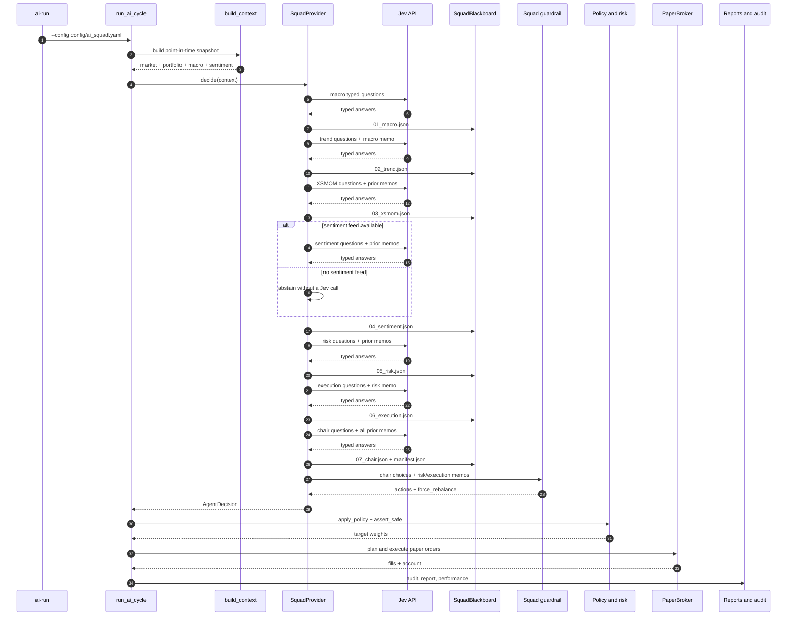
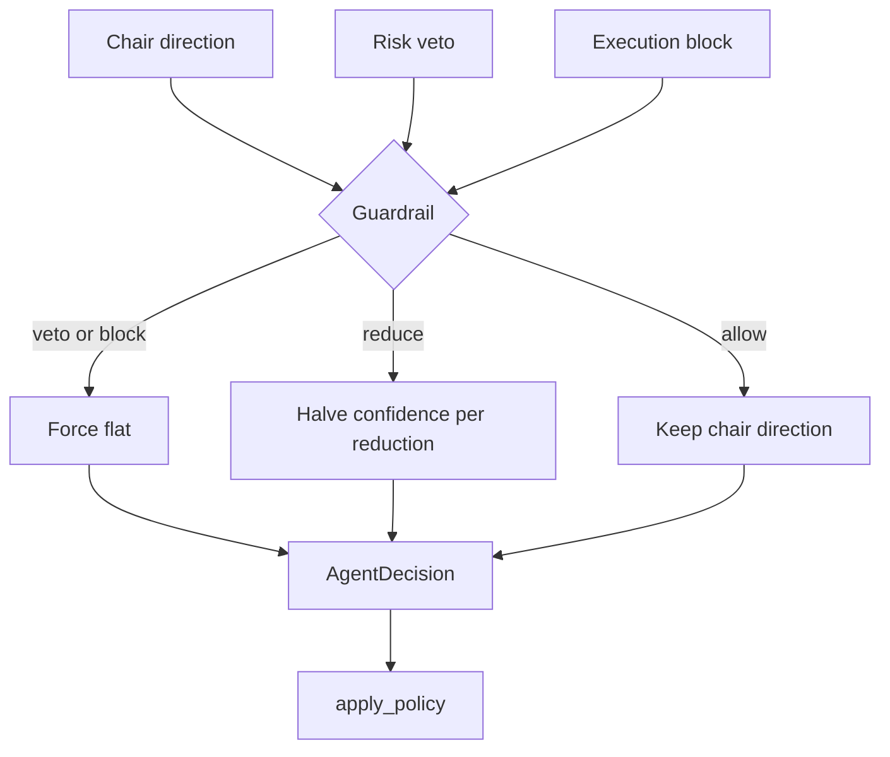
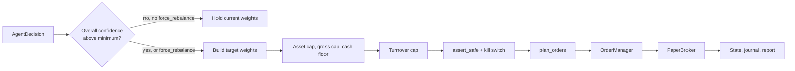

# 25 — AI Squad System Design

**Status:** implemented, paper-only, scheduled daily at 07:25 local; 1 paper day initialized.
**Scope:** the separate seven-agent AI paper lane. The deterministic quant lane is unchanged and does not use Jev.  
**Code:** `src/tradingbot/ai/squad.py`, `src/tradingbot/ai/pipeline.py`, `src/tradingbot/ai/policy.py`.  
**Config:** `config/ai_squad.yaml`.  
**Memory:** `docs/24_AI_SQUAD.md`.

---

## 1. One-page system view



The two lanes share **read-only market data and code**, but not accounts,
state, reports, performance, or order paths.

---

## 2. Who has authority?

| Layer | Authority | Can it execute an order? |
|---|---|---|
| Macro agent | Advisory regime | No |
| Trend agent | Advisory per-asset direction | No |
| XSMOM agent | Advisory relative-strength direction | No |
| Sentiment agent | Advisory sentiment label; may abstain | No |
| Risk critic | **Binding approve / reduce / veto** | No |
| Execution analyst | **Binding allow / reduce / block** | No |
| Chair | Final AI direction after reading all memos | No |
| Deterministic guardrail | Enforces veto/block/reduction and `force_rebalance` | No |
| AI policy | Sizing, gross/net caps, cash, turnover | No |
| Risk engine | Hard risk checks and kill switch | No |
| Paper broker | Executes the approved paper orders | Paper only |

**Jev is the model behind all seven agents, but Jev never receives broker
credentials and never writes an order.** The chair is the final AI decision;
the deterministic policy is the final capital-allocation authority.

### Same model, seven roles

This is a multi-agent **orchestration**, not seven different models:

- all seven roles call the same Jev endpoint/model;
- each call has a different role prompt and typed question set;
- agents return typed choices, not free-form chat;
- no agent calls tools, browses, or reads the broker;
- no agent can see future rows or post-decision information.

### Data and secret boundary

The point-in-time context contains only:

- market features derived from completed daily bars;
- paper account cash, equity, and positions;
- the deterministic policy constraints;
- optional macro and sentiment snapshots.

It does **not** contain:

- broker API keys;
- `TYPESAFE_API_KEY` or any `.env` content;
- account numbers;
- future bars or post-decision data;
- a live order handle.

The Jev API receives this bounded context and the prior memos. It never receives
broker credentials.

The sentiment agent is special: if the sentiment snapshot is unavailable, it
writes an `unavailable` memo **without making a Jev call**. That is why a cycle
normally makes **six calls** today (no sentiment file) and **seven** when a
sentiment feed exists.

---

## 3. Agent dependency graph

The agents run in a fixed sequence. Each later agent receives the full
point-in-time context plus the memos already written.



### Dependency matrix

| Agent | Raw context | Macro | Trend | XSMOM | Sentiment | Risk | Execution | Chair |
|---|---:|---:|---:|---:|---:|---:|---:|---:|
| Macro | ✅ | — | — | — | — | — | — | — |
| Trend | ✅ | ✅ | — | — | — | — | — | — |
| XSMOM | ✅ | ✅ | ✅ | — | — | — | — | — |
| Sentiment | ✅ | ✅ | ✅ | ✅ | — | — | — | — |
| Risk | ✅ | ✅ | ✅ | ✅ | ✅ | — | — | — |
| Execution | ✅ | ✅ | ✅ | ✅ | ✅ | ✅ | — | — |
| Chair | ✅ | ✅ | ✅ | ✅ | ✅ | ✅ | ✅ | — |

**Important:** dependencies are one-way. No agent reads a memo from a later
agent. The chair never sends information backward. The blackboard is a
per-run record, not a long-term memory store.

---

## 4. Runtime sequence



---

## 5. Agent-by-agent design

### 5.1 Macro analyst

| Item | Detail |
|---|---|
| Stage | 1 |
| Questions | `macro_regime` |
| Output | `risk_on` / `neutral` / `risk_off` |
| Dependencies | Raw point-in-time context only |
| Consumers | Trend, XSMOM, sentiment, risk, execution, chair |
| Failure behavior | No special abstention; uses market breadth/volatility if macro data is absent |
| Can do | Set the broad risk backdrop |
| Cannot do | Pick assets, size positions, place orders |

The macro agent is intentionally first because every later agent needs a common
backdrop. It does not need to know what the trend or risk agents think.

### 5.2 Trend analyst

| Item | Detail |
|---|---|
| Stage | 2 |
| Questions | `trend_regime`, `trend_<asset>` |
| Output | Per asset: `long` / `flat` (and `short` only if policy allows) |
| Dependencies | Raw context + macro memo |
| Consumers | XSMOM, sentiment, risk, execution, chair |
| Failure behavior | Missing asset answer → `flat`; invalid choice → `flat` |
| Can do | Describe time-series trend and momentum |
| Cannot do | Size, choose execution method, or make risk decisions |

### 5.3 XSMOM analyst

| Item | Detail |
|---|---|
| Stage | 3 |
| Questions | `xs_regime`, `xs_<asset>` |
| Output | Per asset: relative-strength leader (`long`) or not (`flat`) |
| Dependencies | Raw context + macro and trend memos |
| Consumers | Sentiment, risk, execution, chair |
| Failure behavior | Missing asset answer → `flat` |
| Can do | Compare assets and identify relative-strength leaders |
| Cannot do | Treat absolute trend as sufficient; size or execute |

XSMOM is deliberately separate from trend. Trend asks “is this asset going
up?”; XSMOM asks “is this asset stronger than its peers?” The chair may see
both and decide which evidence is more relevant.

### 5.4 Sentiment analyst

| Item | Detail |
|---|---|
| Stage | 4 |
| Questions | `sentiment_<asset>` |
| Output | `supportive` / `neutral` / `negative` / `unavailable` |
| Dependencies | Raw context + macro, trend, and XSMOM memos |
| Consumers | Risk, execution, chair |
| Failure behavior | Feed absent → abstain without Jev call; missing answer → `unavailable` |
| Can do | Summarise a prepared sentiment snapshot |
| Cannot do | Scrape X/news, infer sentiment from price, size, veto, or execute |

There is no real X feed in the repository. The sentiment agent reads a prepared
`data/normalized/sentiment.parquet` snapshot if it exists. Without that file it
writes a `model: "none"` memo and does not spend a Jev call.

**Sentiment is advisory.** It can inform the chair, but it cannot force a
position. This avoids a noisy or missing feed becoming a hard trading veto.

### 5.5 Risk critic

| Item | Detail |
|---|---|
| Stage | 5 |
| Questions | `risk_regime`, `risk_<asset>` |
| Output | Per asset: `approve` / `reduce` / `veto` |
| Dependencies | Raw context + macro, trend, XSMOM, and sentiment memos |
| Consumers | Execution, chair, deterministic guardrail |
| Failure behavior | Missing asset answer → `veto` (fail closed) |
| Can do | Veto or reduce any proposal; protect against concentration and correlation |
| Cannot do | Size positions, create new positions, or execute |

The risk critic sees the specialist proposals but **does not see the execution
memo** because execution runs after risk. The chair sees both.

### 5.6 Execution analyst

| Item | Detail |
|---|---|
| Stage | 6 |
| Questions | `execution_regime`, `execution_<asset>` |
| Output | Per asset: `allow` / `reduce` / `block` |
| Dependencies | Raw context + all five previous memos, including risk |
| Consumers | Chair and deterministic guardrail |
| Failure behavior | Missing asset answer → `block` (fail closed) |
| Can do | Judge liquidity/feasibility and block or reduce |
| Cannot do | Predict returns, choose direction, size, or execute |

The execution analyst currently uses:

- volume z-score;
- volatility;
- current portfolio weights;
- turnover constraints;
- the risk memo.

It does **not** yet have order-book depth, live spreads, or historical TCA.
“Execution review” therefore means “is this exposure operationally plausible
given the available data?”, not “simulate the order book.”

### 5.7 Chair

| Item | Detail |
|---|---|
| Stage | 7 |
| Questions | `regime`, `<asset>` |
| Output | Final regime and per-asset `long` / `flat` (`short` only if allowed) |
| Dependencies | Raw context + all six prior memos |
| Consumers | Deterministic guardrail, policy, risk, paper broker |
| Failure behavior | Missing chair answer → `flat` |
| Can do | Synthesise every memo into the final AI direction |
| Cannot do | Bypass risk/execution, size, or place orders |

The chair is the **only agent whose output is converted directly into an
`AgentDecision`**. It receives all prior memos, including the risk vetoes and
execution blocks, and is instructed to respect them. Code still enforces them
even if the chair disobeys.

---

## 6. Shared memo contract

Every memo written to the blackboard has this shape:

```json
{
  "agent": "trend_analyst",
  "stage": "trend",
  "as_of": "2026-10-24T00:00:00+00:00",
  "model": "jev-1.14.0",
  "regime": "neutral",
  "confidence": 0.62,
  "choices": {
    "BTCUSDT": "flat",
    "ETHUSDT": "flat"
  },
  "choice_confidence": {
    "BTCUSDT": 0.71,
    "ETHUSDT": 0.58
  },
  "notes": "Trend signal only; no sizing or execution.",
  "usage": {
    "input_tokens": 4200,
    "output_tokens": 120
  },
  "latency_ms": 280.0,
  "answers": {
    "trend_regime": {
      "type": "choice",
      "choice": "neutral",
      "confidence": 0.64
    }
  }
}
```

The shared state sent to a later agent is:

```json
{
  "...": "original point-in-time context",
  "squad": {
    "stage": "risk",
    "memos": {
      "macro": {"...": "memo"},
      "trend": {"...": "memo"},
      "xsmom": {"...": "memo"},
      "sentiment": {"...": "memo"}
    }
  }
}
```

No API key, broker credential, or secret is placed in a memo.

---

## 7. Blackboard and artifacts

```text
artifacts/ai_squad/
  paper_state.json                 # paper account state
  performance.jsonl                # one paper performance row per cycle
  orders.sqlite                    # AI squad order journal
  order_state.sqlite               # idempotent order state machine
  heartbeat.json                   # operational heartbeat
  decisions.jsonl                  # append-only decision history
  reports/
    latest.json
    latest.md
    scorecard.json
    scorecard.md
  audit/
    <timestamp>_squad.json         # request/response/policy/orders audit
  squad/
    <run_id>/
      01_macro.json
      02_trend.json
      03_xsmom.json
      04_sentiment.json
      05_risk.json
      06_execution.json
      07_chair.json
      manifest.json
```

The audit file is written by the existing AI pipeline (`write_audit`), not by
the agents. The blackboard is a readable research record, not an execution
queue.

---

## 8. Deterministic guardrail

The guardrail is the bridge between the LLM squad and the existing AI pipeline.
It is not an agent and does not call a model.



Rules:

1. If risk says `veto`, or execution says `block`, the final action is `flat`.
2. If risk or execution says `reduce`, the chair confidence is multiplied by
   `0.5` for each reduction. Two reductions therefore produce `0.25`.
3. If the chair chooses `short` and policy disallows shorts, the action becomes
   `flat`.
4. If macro, risk, or execution is stressed, a chair `risk_on` regime is
   downgraded to `neutral`.
5. If any veto/block exists, or every chair action is flat, the decision sets
   `force_rebalance = true`.
6. `force_rebalance` prevents the generic “low confidence means hold current
   weights” rule from silently ignoring a veto on an existing position.
7. The existing `max_turnover` cap may still stage an exit instead of forcing
   an unlimited one-day liquidation.

The last point is deliberate: a risk veto changes the target, but the
deterministic policy still controls trading speed and cost.

---

## 9. Policy and execution path



The policy still owns:

- long-only unless explicitly enabled;
- inverse-vol sizing for discrete actions;
- per-asset cap;
- gross cap and risk-off cap;
- minimum cash;
- one-way turnover cap;
- confidence gating.

The broker is still the existing `PaperBroker`. The squad has no other
execution route.

---

## 10. Failure and abstention behavior

| Event | Behavior |
|---|---|
| Jev API unavailable | Pipeline records an error; with `fallback: none` it holds existing positions and sends no orders |
| Jev returns no usable answers | Provider error; no decision |
| Missing risk answer | Defaults to `veto` |
| Missing execution answer | Defaults to `block` |
| Missing chair answer | Defaults to `flat` |
| Sentiment file absent | Sentiment memo is `unavailable`; no Jev call |
| Macro file absent | Macro agent still uses market breadth/volatility |
| Stale market data | Pipeline adds a stale-data alert |
| Kill switch active | Risk checks reject the cycle |
| Blackboard write failure | Pipeline fails before any order; no partial execution |

The default configuration uses `fallback: none`. An AI outage must not silently
become a different strategy.

---

## 11. Why this design

### Sequential instead of parallel

The dependencies are real: risk needs proposals, execution needs risk, and the
chair needs every memo. Running sequentially makes the information flow
auditable and deterministic. The cost is latency: six or seven Jev calls in
series. At Jev’s reported speed and this context size, that is still seconds,
not minutes.

### Typed roles instead of free-form chat

Each agent gets a narrow typed question set. This avoids:

- unconstrained agent-to-agent loops;
- hidden chain-of-thought sharing;
- prompt-injection chatter;
- unbounded token cost;
- output that cannot be validated.

### Jev for every role for now

Using one model keeps the experiment controlled. If we later give sentiment or
execution a different model, the blackboard and deterministic guardrail stay the
same; only the provider mapping changes. That would be a new experiment, not a
silent architecture change.

### No long-term memory

The blackboard is per run. Agents do not learn from prior runs or read old
memos. The only retained history is in the report, audit, decisions, and
performance artifacts. This avoids look-ahead and uncontrolled memory drift.

### No live path

The squad ends at the existing AI paper pipeline. There is no live broker
adapter in the squad. Promotion would require the same evidence, risk, and live
gates as the deterministic campaign, and AI live execution is not implemented.

---

## 12. Runtime and current status

```powershell
# Decision only; no orders
uv run python -m tradingbot --config config/ai_squad.yaml ai-run --dry-run

# Paper cycle
uv run python -m tradingbot --config config/ai_squad.yaml ai-run

# Scorecard
uv run python -m tradingbot --config config/ai_squad.yaml ai-evaluate

# Latest report
uv run python -m tradingbot --config config/ai_squad.yaml ai-status
```

Current status:

- separate $10,000 paper account;
- `TradingBotAISquad` scheduled daily at 07:25 local;
- included in campaign health;
- dedicated **AI squad** Streamlit view and Vercel squad status line;
- one full-roster dry run and one actual paper cycle completed;
- six Jev calls because sentiment data is absent;
- all seven memos were written;
- no orders were sent (the chair chose flat).

The deterministic strategy freeze and the 56-day evidence window are unchanged.
The hard live gate remains `NO_GO`.

---

## 13. Code map

| File | Role |
|---|---|
| `src/tradingbot/ai/squad.py` | Seven agents, typed questions, blackboard, guardrail, final `AgentDecision` |
| `src/tradingbot/ai/providers.py` | `JevProvider.ask()` and provider registration |
| `src/tradingbot/ai/pipeline.py` | Point-in-time context, paper account, policy, orders, reports, audit |
| `src/tradingbot/ai/policy.py` | Sizing, caps, cash, turnover, confidence gate |
| `src/tradingbot/ai/decision.py` | `AgentDecision`, `AssetDecision`, `force_rebalance` |
| `src/tradingbot/portfolio/risk.py` | Hard safety checks and kill switch |
| `src/tradingbot/ops/campaign_health.py` | Daily freshness checks for all campaigns, including `ai_squad` |
| `src/tradingbot/ops/dashboard.py` | Read-only **AI squad** view and competition overview |
| `app.py` | Vercel lite status page, including the squad status line |
| `config/ai_squad.yaml` | Separate paper account and squad configuration |
| `tests/test_ai_squad.py` | Agent order, dependency, veto, block, abstention, blackboard tests |
| `docs/24_AI_SQUAD.md` | Persistent squad decisions and runbook |
