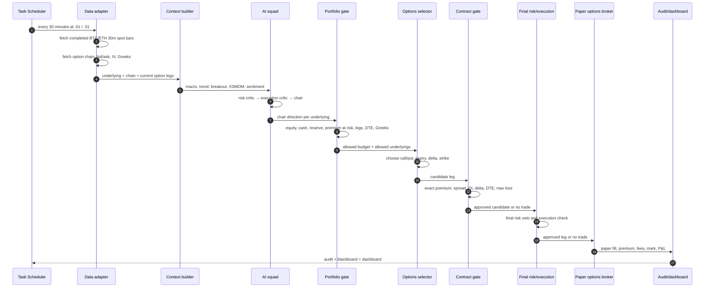

# 28 — Crypto Options: 30m AI Squad Flow

**Status:** design + interactive simulation + deterministic account gates. The
current trading lanes are still spot/cash crypto paper accounts. Crypto options
execution is **not implemented** and is not live.

The deterministic options core exists and is tested: account gates, selector,
paper options broker, one-cycle pipeline, snapshot replay, a read-only Deribit
public-chain adapter, a synthetic 30m replay, a free one-day Tardis real-chain
replay, and a 30m AI options paper cycle. A multi-day purchased archive and live
execution are not built yet.

The animation includes the implemented **breakout specialist** and a 30-minute
options loop. Neither is running yet. The current AI squad is the eight-agent
daily spot squad; the current deterministic intraday lane is hourly spot.

**Phase 1 scope:** BTC and ETH options, 30-minute decision loop, paper-only.

**Open the animation:** `web/ai_options_flow.html`  
**Dashboard view:** **Options flow** in the Streamlit dashboard.

---

## 1. What changes when the target is options, not spot

An options trade is not just a different symbol for the same position. The
system needs four additional layers:

1. **Options market data** — chain, strikes, expiries, bid/ask, mark IV, delta,
   gamma, vega, theta, open interest.
2. **Option selection** — turn a directional view into a call, put, spread, or
   no trade, with an expiry and strike.
3. **Option accounting** — premium paid/received, contract multiplier, fees,
   mark-to-market, expiration/settlement.
4. **Option risk** — premium at risk, net delta, vega, theta decay, expiry,
   liquidity, and spread.

Spot OHLCV remains useful for the underlying signal, but it is not enough to
trade options.

---

## 2. Phase-1 data flow

```mermaid
flowchart LR
    CLOCK[30m timer<br/>:01 and :31] --> SPOT[Binance 30m<br/>BTC + ETH spot bars]
    CLOCK --> CHAIN[Deribit public<br/>option chain]
    CLOCK --> ACCOUNT[(Paper options account<br/>legs, cash, DTE, Greeks)]

    SPOT --> CONTEXT[Point-in-time context builder]
    CHAIN --> CONTEXT
    ACCOUNT --> CONTEXT

    CONTEXT --> MACRO[Macro agent]
    MACRO --> TREND[Trend agent]
    TREND --> BREAKOUT[Breakout agent]
    BREAKOUT --> XS[XSMOM agent]
    XS --> SENT[Sentiment agent<br/>abstains without feed]
    SENT --> RISK[Risk critic]
    RISK --> EXEC[Execution critic]
    EXEC --> CHAIR[Chair<br/>direction only]

    CHAIR --> PORTFOLIO[Portfolio + cash gate<br/>pre-selector]
    PORTFOLIO --> SELECTOR[Deterministic options selector<br/>call/put, DTE, delta, strike]
    SELECTOR --> CONTRACT[Contract gate<br/>post-selector]
    CONTRACT --> RISKCHECK[Final option risk checks<br/>premium, delta, theta, spread]
    RISKCHECK --> BROKER[Paper options broker]
    BROKER --> STATE[(Option state + P&L)]
    STATE --> DASH[Blackboard + dashboard + audit]
```



---

## 3. Runtime sequence



---

## 4. Agent actions

| Stage | Agent | Data it sees | Action | Authority |
|---|---|---|---|---|
| 1 | Macro | Spot breadth, vol, macro snapshot | Risk regime | Advisory |
| 2 | Trend | 30m spot features | BTC/ETH direction | Advisory |
| 3 | Breakout | Range, high/low, volume | Breakout / no breakout | Advisory |
| 4 | XSMOM | Relative BTC/ETH strength | Leader/follower | Advisory |
| 5 | Sentiment | Prepared feed if available | Supportive/negative/unavailable | Advisory |
| 6 | Risk critic | All memos + option risk | Approve/reduce/veto | Binding |
| 7 | Execution critic | Spread, OI, quote quality | Allow/reduce/block | Binding |
| 8 | Chair | All memos | Long/short/flat per underlying | Final AI direction |
| 9 | Options selector | Chair direction + chain | Call/put, DTE, delta, strike | Deterministic |
| 10 | Option risk | Proposed leg + account | Premium/Greek/expiry check | Deterministic |
| 11 | Paper broker | Approved leg | Fill, fee, mark, settle | Paper only |

The options selector is deliberately **not an LLM**. It applies hard rules so a
persuasive agent cannot choose an illiquid or oversized contract.

---

## 5. Why one positions/cash snapshot is not enough

The account snapshot is currently one input to the context. It is **not** a
sufficient trade gate. Options add premium, expiry, Greeks, and contract-size
risk that a spot cash check does not see.

Use **three account checks** per cycle:

| Check | When | What it answers |
|---|---|---|
| Context snapshot | Before agents | What is the current cash, equity, legs, DTE, and mark? |
| **Portfolio + cash gate** | After chair, before selector | How much premium budget is available? Are we below reserve? Too many legs? Expired/near-expiry risk? |
| **Contract gate** | After selector, before broker | Does this exact strike/expiry/quote fit the budget, spread, OI, delta, DTE, and max-loss rules? |
| Final risk/execution | Before broker | Does the deterministic risk/execution layer still approve? |

### Pre-selector portfolio gate

Implemented in `src/tradingbot/options/account.py::check_account`.

It calculates:

- account equity = cash + current option mark value;
- cash reserve = `min_cash_pct × equity`;
- premium at risk = entry premium of all long legs;
- total premium cap = `max_total_premium_pct × equity`;
- available premium = `min(total cap - premium at risk, cash - reserve)`;
- maximum new premium = `min(per-trade cap, available premium)`;
- open legs and legs per underlying;
- net delta, vega, and theta;
- expired and near-expiry positions;
- blockers and warnings.

Example on $10,000:

```text
cash                         $10,000
cash reserve (20%)            $2,000
max total premium (5%)          $500
premium at risk                   $0
available premium               $500
max new trade (2%)              $200
open legs                       0 / 2
```

If $150 of premium is already at risk:

```text
premium at risk                 $150
available premium               $350
max new trade                   $200
```

If two legs are already open, the gate blocks a third leg even if cash remains.

### Post-selector contract gate

Implemented in `src/tradingbot/options/account.py::check_candidate`.

Given a specific contract, it verifies:

- expiry is within the DTE window;
- bid/ask spread is under the cap;
- open interest is above the minimum;
- absolute delta is in the target band;
- premium plus fee fits the new-trade budget;
- the account is not already at the per-underlying leg limit;
- contract count, estimated cost, fees, and maximum loss.

If the candidate fails, the selector must try the next candidate or return
“no trade.” It must not bypass the gate.

### Why not skip the pre-selector gate?

Without it, the selector can choose a “valid” option that is still wrong for the
account:

- premium is affordable individually but breaches the total premium cap;
- cash is positive but below the reserve;
- the account already has two legs;
- an existing leg is about to expire;
- the same underlying already has a position;
- aggregate delta/theta is already too high.

The pre-selector gate answers **“are we allowed to add risk at all?”** The
contract gate answers **“is this exact contract allowed?”**

---

## 5.1 Option selection rules for phase 1

Initial rules, subject to backtest and paper evidence:

| Rule | Initial value |
|---|---|
| Underlyings | BTC and ETH only |
| Direction | Chair long → call; chair short → put; flat → no new leg |
| Expiry | 7-14 days |
| Delta | 0.35-0.55 |
| Max bid/ask spread | 5% of mid |
| Minimum open interest | venue-specific, initially 100 contracts |
| Max premium at risk | 2% of equity per leg |
| Max total premium at risk | 5% of equity |
| Min cash reserve | 20% of equity |
| Max simultaneous option legs | 2 |
| Max legs per underlying | 1 |
| Max net delta | 2.0 contract-delta units |
| Max net vega | 100 |
| Max net theta | 100 |
| Position type | Long premium only; no naked short options |
| Exit | Thesis flip, 50% premium stop, 100% gain, or 2 DTE |
| Settlement | Cash settlement; expiry handled by the paper broker |

### Why long premium first

Buying calls/puts caps the loss at the premium and avoids liquidation,
margin-call, and unlimited-risk behavior. It is the safest first options
implementation. Spreads and covered structures come later.

---

## 6. Option contract sizes matter

The $10,000 account cannot treat all venues the same:

| Venue | Typical BTC option contract | Practical implication |
|---|---:|---|
| Deribit | 1 BTC | One BTC option can consume a large share of a $10k account |
| OKX | 0.01 BTC | Much better granularity for a small account |
| Bybit | 0.01 BTC | Similar small-contract profile |
| Binance options | Venue-specific; verify | Check contract size and settlement |

For a $10,000 account, **ETH options or fractional BTC contracts** are more
realistic than one full BTC contract. Do not size a live position from a paper
contract that is 100× too large.

---

## 7. Fees and venues

Options fees are not the only cost. Spread, IV, and liquidity matter more.

| Venue | Options fee (standard) | Liquidity | Notes |
|---|---:|---|---|
| Deribit | 0.03% maker / 0.03% taker; cap tied to premium | Deepest BTC/ETH options | U.S. restricted; verify Singapore eligibility |
| OKX | ~0.02% maker / 0.03% taker | Good BTC/ETH | 0.01 BTC contract; check Singapore product access |
| Bybit | ~0.02% trading + delivery fee | Good | 0.01 BTC / 0.1 ETH contracts; check eligibility |
| Binance | ~0.03% + exercise fee | Broad but options liquidity is venue-specific | Not MAS-licensed for Singapore retail |

**Lowest headline fee is not automatically the best venue.** Deribit has the
deepest options liquidity; OKX/Bybit may have lower fees and smaller contracts;
Binance has regulatory/access issues for Singapore. Verify current fee schedules
and eligibility directly.

For **US stock options**, Alpaca/IBKR are the usual low-cost choices, but this
phase is crypto-only.

---

## 8. What is deliberately not built

- No live options broker connection.
- No paid multi-day historical options archive; the current real replay is one free Tardis day.
- No options P&L in the current read-only dashboard.
- No claim that the AI squad has options edge.

The animated flow is a **simulation of the intended architecture**, not a
running options strategy.

---

## 9. Build order

### Implemented now

- `src/tradingbot/options/account.py`: pre-selector account gate and
  post-selector contract gate.
- `src/tradingbot/options/selector.py`: deterministic call/put selection and
  contract ranking.
- `src/tradingbot/options/broker.py`: paper premiums, cash, fees, marks,
  expiry settlement, and state persistence.
- `src/tradingbot/options/pipeline.py`: one paper options cycle with close,
  gate, select, buy, mark, and settle steps.
- `src/tradingbot/options/backtest.py`: event-driven replay over recorded or
  synthetic chain snapshots.
- `src/tradingbot/options/deribit.py`: read-only Deribit public option-chain
  adapter and inverse-premium USD approximation.
- `src/tradingbot/options/synthetic.py`: constant-IV Black-Scholes synthetic
  chains for mechanics replay.
- `src/tradingbot/options/ai_pipeline.py`: 30m Jev squad → options paper cycle.
- `src/tradingbot/options/historical.py`: validated CSV/Parquet snapshot loader.
- `src/tradingbot/options/tardis.py`: free Tardis first-day options-chain ingestion.
- `src/tradingbot/options/audit.py`: append-only fill/settlement audit journal.
- `src/tradingbot/options/live_gate.py`: options-specific hard live gate.
- `src/tradingbot/ops/options_evidence.py`: read-only forward/replay evidence scorecard.
- `src/tradingbot/ops/readiness.py`: paper/live readiness summary.
- `scripts/check_host.ps1`: always-on Windows host readiness check.
- `scripts/ingest_tardis_options.py`, `scripts/run_options_tardis_replay.py`,
  `scripts/build_options_evidence.py`, `scripts/self_eval.py`,
  `scripts/build_readiness.py`.
- `config/ai_options_30m.yaml`: separate paper account.
- `scripts/run_ai_options_30m.ps1`, `scripts/register_ai_options_30m.ps1`.
- Tests for gates, selection, paper fills, expiry, state, replay, Deribit
  fixtures, synthetic chains, historical loading, Tardis ingestion, and the
  AI options cycle.
- Interactive flow animation plus dashboard **Options flow**, **Options
  evidence**, and **Readiness** views.
- Kill-switch enforcement before an AI options cycle can refresh data or call
  the model.
- Drawdown auto-kill and append-only fill/settlement audit.
- Separate options live gate, currently **NO_GO**.

Still missing: a multi-day historical chain archive and live execution. The free
one-day sample is not evidence of edge.

### Step 0 — Implemented adapter and synthetic replay

A read-only Deribit public-chain adapter and a synthetic constant-IV chain
generator are implemented. They are research tools, not evidence of profitability.

### Step 1 — Production data adapter

- Deribit public option chain and ticker endpoints.
- Parse expiry, strike, call/put, bid/ask, mark IV, Greeks, OI, volume.
- Cache and timestamp every snapshot.
- Validate stale quotes and missing Greeks.

### Step 2 — Paper options broker

- Contract multiplier and premium accounting.
- Fees and slippage.
- Mark-to-market from mid.
- Expiry and cash settlement.
- Persist option legs separately from spot state.

### Step 3 — Options selector and risk

- Direction-to-call/put mapping.
- DTE, delta, spread, OI, premium-at-risk filters.
- Max legs, max premium, max net delta.
- Exit rules and expiry handling.

### Step 4 — 30m AI signal lane ✅ built

- Separate `ai_options_30m` paper account.
- BTC/ETH only.
- Separate task at :01/:31: `TradingBotAIOptions30m`.
- Per-cycle paper option limits and one contract per cycle.
- Jev squad currently has no breakout specialist; that remains a future agent addition.

### Step 5 — Evidence

- Paper run for at least 20-56 days.
- Track IV entry/exit, premium decay, delta, win rate, and P&L after fees.
- Do not promote to live without the same live gate.

---

## 10. Testing and backtesting

See `docs/29_OPTIONS_TESTING_AND_BACKTEST.md` for the test pyramid, fixture
integration test design, historical options data requirements, backtest fill
rules, and acceptance gates.

---

## 11. Interactive animation

`web/ai_options_flow.html` is a self-contained browser animation with:

- Play / pause / step controls;
- active data path highlighting;
- simulated spot, IV, agent decisions, option selection, risk checks, paper fill;
- event log and current-state panel.

Open it directly in a browser, or use the **Options flow** view in the local
Streamlit dashboard.
