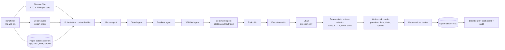
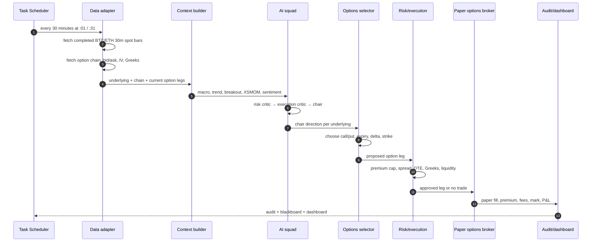

# 28 — Crypto Options: 30m AI Squad Flow

**Status:** design + interactive simulation. The current trading lanes are still
spot/cash crypto paper accounts. Crypto options execution is **not implemented**
and is not live.

The animation includes a proposed **breakout specialist** and a 30-minute
options loop. Neither is running yet. The current AI squad is the seven-agent
daily spot squad; the current deterministic intraday lane is hourly spot.

**Phase 1 scope:** BTC and ETH options, 30-minute decision loop, paper-only.

**Open the animation:** `web/ai_options_flow.html`  
**Dashboard view:** **Options flow** in the Streamlit dashboard.

---

## 1. What changes when the target is options, not spot

An options trade is not just a different symbol for the same position. The
system needs four additional layers:

1. **Options market data** — chain, strikes, expiries, bid/ask, mark IV, delta,
   gamma, vega, theta, open interest.
2. **Option selection** — turn a directional view into a call, put, spread, or
   no trade, with an expiry and strike.
3. **Option accounting** — premium paid/received, contract multiplier, fees,
   mark-to-market, expiration/settlement.
4. **Option risk** — premium at risk, net delta, vega, theta decay, expiry,
   liquidity, and spread.

Spot OHLCV remains useful for the underlying signal, but it is not enough to
trade options.

---

## 2. Phase-1 data flow

---

## 3. Runtime sequence

---

## 4. Agent actions

| Stage | Agent | Data it sees | Action | Authority |
|---|---|---|---|---|
| 1 | Macro | Spot breadth, vol, macro snapshot | Risk regime | Advisory |
| 2 | Trend | 30m spot features | BTC/ETH direction | Advisory |
| 3 | Breakout | Range, high/low, volume | Breakout / no breakout | Advisory |
| 4 | XSMOM | Relative BTC/ETH strength | Leader/follower | Advisory |
| 5 | Sentiment | Prepared feed if available | Supportive/negative/unavailable | Advisory |
| 6 | Risk critic | All memos + option risk | Approve/reduce/veto | Binding |
| 7 | Execution critic | Spread, OI, quote quality | Allow/reduce/block | Binding |
| 8 | Chair | All memos | Long/short/flat per underlying | Final AI direction |
| 9 | Options selector | Chair direction + chain | Call/put, DTE, delta, strike | Deterministic |
| 10 | Option risk | Proposed leg + account | Premium/Greek/expiry check | Deterministic |
| 11 | Paper broker | Approved leg | Fill, fee, mark, settle | Paper only |

The options selector is deliberately **not an LLM**. It applies hard rules so a
persuasive agent cannot choose an illiquid or oversized contract.

---

## 5. Option selection rules for phase 1

Initial rules, subject to backtest and paper evidence:

| Rule | Initial value |
|---|---|
| Underlyings | BTC and ETH only |
| Direction | Chair long → call; chair short → put; flat → no new leg |
| Expiry | 7-14 days |
| Delta | 0.35-0.55 |
| Max bid/ask spread | 5% of mid |
| Minimum open interest | venue-specific, initially 100 contracts |
| Max premium at risk | 2% of equity per leg |
| Max simultaneous option legs | 2 |
| Position type | Long premium only; no naked short options |
| Exit | Thesis flip, 50% premium stop, 100% gain, or 2 DTE |
| Settlement | Cash settlement; expiry handled by the paper broker |

### Why long premium first

Buying calls/puts caps the loss at the premium and avoids liquidation,
margin-call, and unlimited-risk behavior. It is the safest first options
implementation. Spreads and covered structures come later.

---

## 6. Option contract sizes matter

The $10,000 account cannot treat all venues the same:

| Venue | Typical BTC option contract | Practical implication |
|---|---:|---|
| Deribit | 1 BTC | One BTC option can consume a large share of a $10k account |
| OKX | 0.01 BTC | Much better granularity for a small account |
| Bybit | 0.01 BTC | Similar small-contract profile |
| Binance options | Venue-specific; verify | Check contract size and settlement |

For a $10,000 account, **ETH options or fractional BTC contracts** are more
realistic than one full BTC contract. Do not size a live position from a paper
contract that is 100× too large.

---

## 7. Fees and venues

Options fees are not the only cost. Spread, IV, and liquidity matter more.

| Venue | Options fee (standard) | Liquidity | Notes |
|---|---:|---|---|
| Deribit | 0.03% maker / 0.03% taker; cap tied to premium | Deepest BTC/ETH options | U.S. restricted; verify Singapore eligibility |
| OKX | ~0.02% maker / 0.03% taker | Good BTC/ETH | 0.01 BTC contract; check Singapore product access |
| Bybit | ~0.02% trading + delivery fee | Good | 0.01 BTC / 0.1 ETH contracts; check eligibility |
| Binance | ~0.03% + exercise fee | Broad but options liquidity is venue-specific | Not MAS-licensed for Singapore retail |

**Lowest headline fee is not automatically the best venue.** Deribit has the
deepest options liquidity; OKX/Bybit may have lower fees and smaller contracts;
Binance has regulatory/access issues for Singapore. Verify current fee schedules
and eligibility directly.

For **US stock options**, Alpaca/IBKR are the usual low-cost choices, but this
phase is crypto-only.

---

## 8. What is deliberately not built

- No crypto options data adapter yet.
- No option paper broker yet.
- No option selector/risk engine yet.
- No live options broker connection.
- No historical options backtest yet.
- No options P&L in the current dashboard.
- No claim that the AI squad has options edge.

The animated flow is a **simulation of the intended architecture**, not a
running options strategy.

---

## 9. Build order

### Step 1 — Data adapter

- Deribit public option chain and ticker endpoints.
- Parse expiry, strike, call/put, bid/ask, mark IV, Greeks, OI, volume.
- Cache and timestamp every snapshot.
- Validate stale quotes and missing Greeks.

### Step 2 — Paper options broker

- Contract multiplier and premium accounting.
- Fees and slippage.
- Mark-to-market from mid.
- Expiry and cash settlement.
- Persist option legs separately from spot state.

### Step 3 — Options selector and risk

- Direction-to-call/put mapping.
- DTE, delta, spread, OI, premium-at-risk filters.
- Max legs, max premium, max net delta.
- Exit rules and expiry handling.

### Step 4 — 30m AI signal lane

- Separate `ai_options_30m` paper account.
- BTC/ETH only.
- Add breakout specialist to the squad.
- Separate task at :01/:31.
- Per-cycle turnover cap and no-trade band.

### Step 5 — Evidence

- Paper run for at least 20-56 days.
- Track IV entry/exit, premium decay, delta, win rate, and P&L after fees.
- Do not promote to live without the same live gate.

---

## 10. Interactive animation

`web/ai_options_flow.html` is a self-contained browser animation with:

- Play / pause / step controls;
- active data path highlighting;
- simulated spot, IV, agent decisions, option selection, risk checks, paper fill;
- event log and current-state panel.

Open it directly in a browser, or use the **Options flow** view in the local
Streamlit dashboard.
