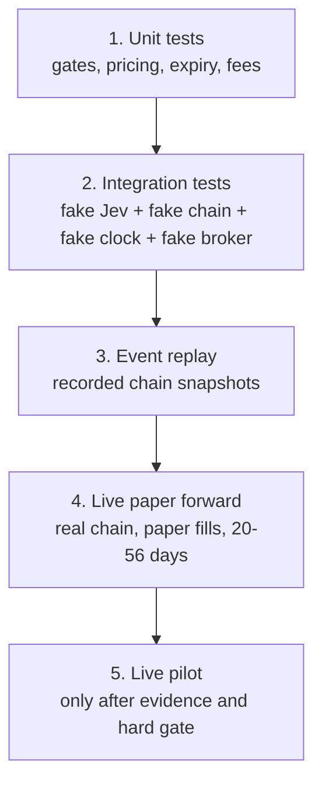

# 29 — Testing and Backtesting the Options Flow

**Status:** account gates, selector, paper broker, one-cycle pipeline, AI
decision-to-direction adapter, 30m AI options paper cycle, Deribit public-chain
adapter, synthetic chain generator, historical CSV/Parquet loader, and
event-driven snapshot replay are built and tested. A purchased historical chain
dataset is **not present yet**.
**Current tests:** gates, selector, paper fills, expiry settlement, state
round-trip, AI action mapping, Deribit fixture parsing, synthetic chains,
historical snapshot loading, and snapshot replay.

The animation in `web/ai_options_flow.html` is a **simulation**, not a backtest,
not a paper run, and not evidence of edge.

---

## 1. What can be tested today

| Test | Status | What it proves |
|---|---|---|
| Account gate unit tests | **Built** | Budget, reserve, leg count, expiry, spread, OI, delta, DTE, fees |
| Animated flow | **Built** | The intended sequence is understandable |
| Options selector | **Built** | Calls/puts, candidate ranking, gates |
| Paper options broker | **Built** | Cash, premium, fees, marks, settlement, state |
| One-cycle flow | **Built** | Close → gate → select → buy → mark |
| Snapshot replay backtester | **Built** | Event-driven replay over recorded or synthetic chains |
| AI decision adapter | **Built** | Maps typed actions/weights to long/short/flat option directions |
| Deribit public-chain adapter | **Built** | Read-only chain and USD approximation; fixture-tested |
| Synthetic chain generator | **Built** | Constant-IV Black-Scholes mechanics test |
| Historical chain dataset | Not built | No paid historical quote archive yet |
| 30m AI options paper cycle | **Built** | Jev squad → directions → gates → paper broker |
| 30m scheduled paper task | **Built** | `TradingBotAIOptions30m` every 30 minutes |
| Historical CSV/Parquet loader | **Built** | Validated snapshot input |
| Purchased historical chain dataset | Missing | Needs vendor purchase |
| Live-chain paper forward | **Started** | Runs every 30m; not yet several days |
| Live options | Blocked | No live gate approval |

Run the existing gate tests:

```powershell
uv run pytest tests/test_options_account.py -q
```

---

## 2. Test pyramid



### Level 1 — Unit tests

- Account gate: cash reserve, premium cap, per-trade cap, leg count.
- Candidate gate: DTE, spread, open interest, delta, fees, max loss.
- Option pricing: mark, intrinsic value, expiry settlement.
- Fee and multiplier accounting.
- Blocking rules and warnings.

### Level 2 — Integration test with no network

Use a fake:

- Jev provider returning fixed typed answers;
- option chain fixture with fixed timestamps;
- clock fixed at `2026-10-24T10:00Z`;
- paper broker fill logger;
- account state in a temporary directory.

Run one complete cycle and assert:

```text
context → macro → trend → breakout → xsmom → sentiment
→ risk → execution → chair
→ portfolio gate → selector → contract gate
→ paper fill → audit
```

Test cases:

- premium budget too small → no trade;
- two legs already open → pre-gate blocks;
- cash below reserve → pre-gate blocks;
- chain missing Greeks → no trade;
- quote stale → no trade;
- spread too wide → contract gate blocks;
- open interest too low → contract gate blocks;
- DTE too short → contract gate blocks;
- candidate cost over budget → zero contracts;
- broker rejects fill → audit error and no state corruption;
- restart between gate and fill → reconciliation sees no duplicate order.

This is the fastest way to test the flow without a venue or live data.

### Level 3 — Replay with recorded option-chain snapshots

Record snapshots and replay them through the same pipeline:

- same decision timestamps;
- same chain state;
- same fills and fees;
- same clock.

This catches sequencing bugs and look-ahead mistakes without market risk.

### Level 4 — Live paper forward

Use the real public option chain and paper fills for **20-56 days**. This tests:

- actual quote gaps;
- stale/illiquid contracts;
- missing Greeks;
- API rate limits;
- expiry handling;
- operational reliability;
- the difference between modeled and observed spreads.

### Level 5 — Live pilot

Not before the hard live gate. Long premium only, tiny size, no naked shorts,
no options margin, and a kill switch.

---

## 3. Can this be backtested?

**Yes, but options backtesting needs different data from spot.**

A spot backtest only needs OHLCV. An options backtest needs, at every decision
time:

- underlying spot/index price;
- every strike and expiry;
- call/put;
- bid and ask;
- mark price;
- implied volatility;
- delta, gamma, vega, theta;
- open interest and volume;
- contract multiplier and settlement currency;
- fees and expiry calendar.

Without historical quotes and Greeks, you cannot honestly backtest 30-minute
option selection and fills.

---

## 4. Three levels of options backtest

### A. Synthetic options backtest — free, approximate

Use:

- historical 30m spot bars;
- Deribit DVOL or realized volatility as the vol input;
- Black-Scholes to create a synthetic chain;
- conservative spread and fees.

This tests:

- signal logic;
- DTE/strike selection;
- expiry and theta handling;
- risk gates and cash accounting.

It does **not** test:

- actual IV surface;
- actual bid/ask;
- skew;
- liquidity;
- venue-specific inverse/USDT settlement;
- real execution.

Useful as a first smoke test, not as evidence of profitability.

### B. Historical option-chain replay — credible, paid data

Use recorded snapshots with actual bid/ask, IV, Greeks, and OI. Fill buys at the
ask and sells at the bid, add fees and slippage, and settle at expiry.

This is the right backtest for the options selector.

### C. Live paper forward — most realistic for operations

Use the real-time public chain and paper fills. This captures current spreads,
quote gaps, and API behavior. It is not a historical backtest and needs at least
20-56 days.

---

## 5. Where to get historical crypto-options data

| Source | Data | Cost | Notes |
|---|---|---|---|
| Deribit public API | Live chain, ticker, Greeks, IV | Free | Not a complete free historical quote archive |
| Deribit DVOL | Historical implied-vol index | Free | Useful for synthetic pricing |
| CryptoDataDownload | Daily option OHLCV by expiry | Free/paid tiers | Too coarse for 30m fills |
| Tardis.dev | Deribit historical trades, books, tickers, mark IV, Greeks | Paid subscription | Deep history; strong for replay |
| CryptoStruct | Deribit option-chain day bundles, L2, mark IV, Greeks | ~€1 per contract-day / option-chain day | Day-level purchase, good for a limited replay |
| CoinAPI | Deribit/Binance/OKX/Bybit options, Greeks, L2 | Commercial | Broad normalized coverage |
| Amberdata | Crypto options surfaces and analytics | Commercial | Institutional-grade |
| OKX/Bybit APIs | Live chain and public market data | Free | Historical quote depth may be limited |

For a first limited replay, CryptoStruct day bundles or Tardis are more practical
than trying to reconstruct historical quotes from trade prints.

**Do not buy a large data package before a synthetic backtest and a fixture
integration test pass.**

---

## 6. Backtest design that avoids fooling yourself

### Decision timing

- Decision at the close of a completed 30m bar.
- Use only option quotes available at or before that timestamp.
- Fill at the **next available quote**, not the current mid, if the quote is
  delayed.
- Never use a later revised IV or mark.

### Fill model

- Buy at ask + slippage.
- Sell at bid - slippage.
- Include venue fees.
- No fill if spread, OI, or quote age fails.
- No fill if the contract size is below one.
- For long options, maximum loss is premium + fees.

### Expiry and settlement

- Track expiry timestamps.
- Stop new entries at the DTE minimum.
- Settle at expiry using the venue’s settlement rule.
- Distinguish inverse (Deribit) from USDT-margined options.
- Do not treat expired options as tradable indefinitely.

### Portfolio accounting

- Cash decreases by premium + fee.
- Long option market value uses bid, not ask.
- Equity = cash + conservative mark.
- Reconcile every fill and expiry.
- Use the existing pre-selector and contract gates.

### Walk-forward

- Split by time, not by contract.
- Include option expiries and regime changes.
- Report DSR/PBO after costs.
- Compare 30m, 1h, and daily signal cadence.
- Compare 7/14/30 DTE and delta bands.

---

## 6.1 Synthetic replay result

A synthetic 30m BTC/ETH replay was run on 999 recent bars with:

- constant 50% IV;
- 7/14/30-day synthetic expiries;
- 2% synthetic spread;
- 3 bps fee;
- 200-bar trend signal;
- long-premium only.

Observed mechanics result:

```text
snapshots       999
fills            53
final equity     $9,768.02
return          -2.32%
max drawdown    -3.29%
fees            $1.49
```

This is **not evidence of edge**. It shows that the pipeline can open, mark,
roll, and close synthetic option positions. The loss is driven by synthetic
spreads and signal churn.

Script:

```powershell
uv run python scripts/run_options_synthetic.py
```

Output:

```text
artifacts/options_synthetic/synthetic_replay.json
```

## 6.2 AI options paper cycle

The 30m paper lane is:

```text
30m BTC/ETH bars
→ Jev squad direction
→ Deribit public chain
→ portfolio gate
→ call/put selector
→ contract gate
→ paper options broker
→ report + performance + heartbeat
```

Run one cycle:

```powershell
uv run python -m tradingbot --config config/ai_options_30m.yaml ai-options-run --dry-run
uv run python -m tradingbot --config config/ai_options_30m.yaml ai-options-run
```

Scheduled task:

```text
TradingBotAIOptions30m — every 30 minutes
```

Current first cycles returned BTC flat / ETH flat, so no option order was placed.
The task is registered for :01/:31, remains paper-only, and has started the
live-chain paper forward clock.

### Historical snapshot input

`src/tradingbot/options/historical.py` loads a validated CSV or Parquet export
with timestamp, instrument, bid/ask, Greeks, open interest, and underlying
price. A purchased or otherwise licensed chain sample can therefore be replayed
without changing the engine.

A paid vendor sample has **not** been purchased. That item remains blocked on
budget/vendor selection, not code.

## 6.3 Replay API

The replay engine is:

```python
from tradingbot.options.backtest import OptionSnapshot, replay_options

snapshots = [
    OptionSnapshot(timestamp=ts, chain=chain, underlying_prices=prices),
]

def signal(snapshot):
    return {"BTC": "long", "ETH": "flat"}

result = replay_options(snapshots, signal)

# Or map a typed AI decision:
from tradingbot.options.signals import directions_from_decision
directions = directions_from_decision(
    decision,
    {"BTCUSDT": "BTC", "ETHUSDT": "ETH"},
)
```

This is a framework. It is **not** a profitable backtest until the snapshots are
real historical option-chain data with bid/ask and Greeks.

---

## 7. Metrics to report

| Metric | Why |
|---|---|
| Net P&L after fees/spread | The only result that matters |
| Sharpe / Sortino | Return per unit of risk |
| Max drawdown | Survival |
| Win rate and average win/loss | Distribution |
| Premium at risk / equity | Sizing |
| Average DTE at entry/exit | Theta exposure |
| Average entry/exit IV | Vol edge |
| Delta, vega, theta | Risk attribution |
| Number of trades and turnover | Cost control |
| Gate rejection counts | Are limits doing the work? |
| Slippage vs model | Realism |
| Expiry outcomes | Settlement handling |

---

## 8. Acceptance gates for a 30m options strategy

Do not proceed to live unless all are true:

- positive net P&L after realistic fees and bid/ask;
- DSR ≥ 0.95 and PBO ≤ 0.20 on the option strategy trials;
- drawdown within the configured limit;
- no naked short options;
- no operational failure in 56 paper days;
- options data and broker reconciliation are clean;
- venue eligibility and tax treatment are confirmed.

The current live gate remains **NO_GO**.

---

## 9. Practical build order

| Step | Status |
|---|---|
| Fixture integration test | **Built** |
| Paper options broker | **Built** |
| Option selector and gates | **Built** |
| Snapshot replay engine | **Built** |
| Deribit public data adapter | **Built** |
| Synthetic 30m options replay | **Built** |
| AI-squad 30m signal integration | **Built** |
| 30m scheduled paper forward | **Started** |
| Paid historical chain replay | Blocked on vendor purchase |
| Live pilot | Only after the hard gate |

The first code milestone is complete. The next build is the **venue data adapter**
and its recorded-fixture contract tests.
