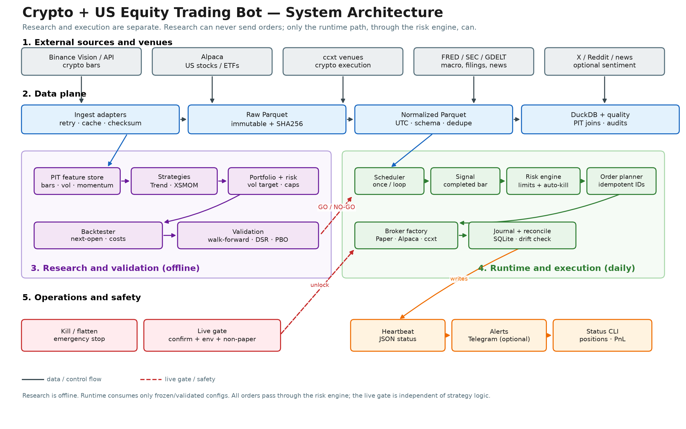
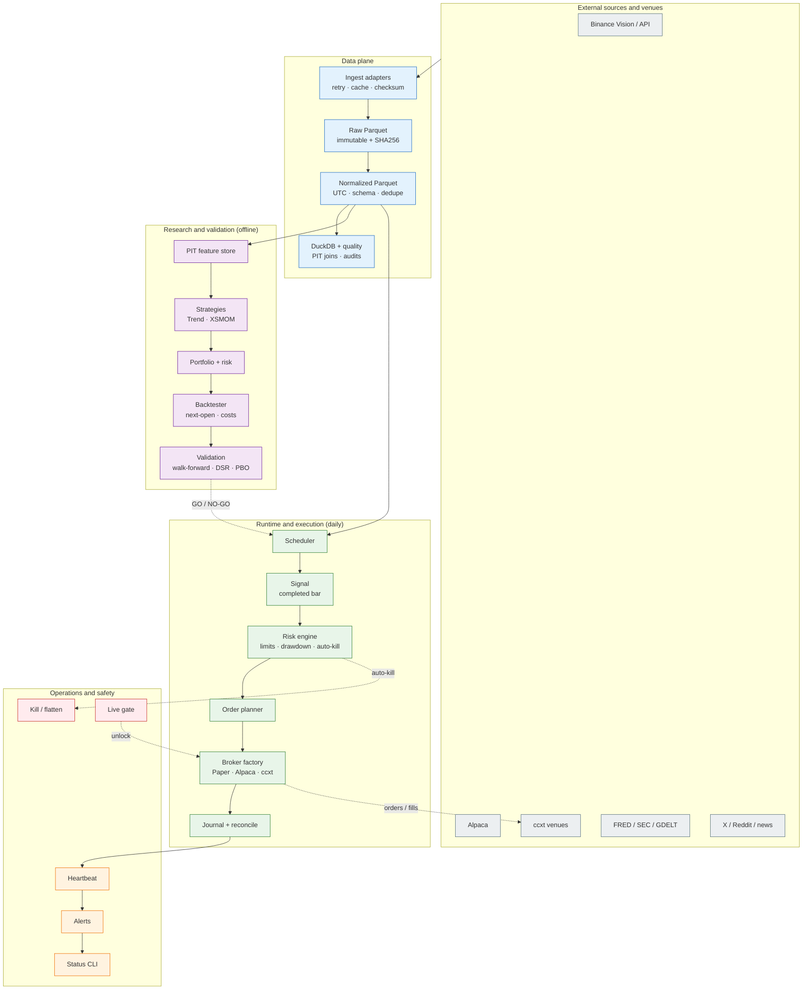
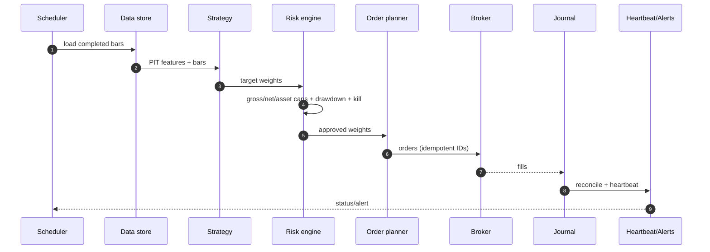

# Architecture

Generated by `uv run python scripts/draw_architecture.py`.  
Editable source: `scripts/draw_architecture.py`. SVG: `docs/architecture.svg`.

---

## 1. Design invariants

1. **Research cannot place orders.** Only the runtime path, through the risk engine, can reach a broker.
2. **Point-in-time data only.** Every feature join respects `knowledge_time <= decision_time`.
3. **One risk engine.** Gross/net/asset caps, drawdown throttle, kill switch, and live gate are independent of strategy code.
4. **One execution path.** Paper and live use the same order planner, journal, and reconciliation; only the broker adapter changes.
5. **Fail closed.** Missing data, stale bars, drawdown breach, kill file, or failed live gate stops the cycle.
6. **Immutable raw data.** Vendor files are stored raw with checksums; normalized data is reproducible from them.
7. **Two isolated accounts.** The deterministic campaign and the AI-agent campaign have separate configs, state, journals, performance histories, reports, and kill switches. The dashboard only reads both.

---

## 2. Layers

### External sources and venues
- Binance Vision/API: crypto bars.
- Alpaca: US stocks/ETFs.
- ccxt: crypto execution.
- FRED/SEC/GDELT: macro, filings, news.
- X/Reddit/news: optional sentiment (not in the order path).

### Data plane
- **Ingest adapters** with retry, caching, and checksum verification.
- **Raw Parquet**: immutable vendor files + SHA256 manifests.
- **Normalized Parquet**: UTC timestamps, stable schema, deduplication.
- **DuckDB + quality**: PIT joins, missing-bar checks, OHLC audits, delisting/universe checks.

### Research and validation (offline)
- **PIT feature store**: returns, volatility, momentum, funding/basis, macro, sentiment.
- **Strategies**: trend and cross-sectional momentum.
- **Portfolio + risk**: volatility targeting, correlation/asset caps, turnover control.
- **Backtester**: next-open fills, commissions, slippage, funding/borrow.
- **Validation**: walk-forward, purged CV/CPCV, DSR, PBO, cost stress.

The validation gate is a **hard GO/NO-GO**. A strategy is promoted to runtime only after it clears the protocol in `docs/05_VALIDATION_PROTOCOL.md`.

### Runtime and execution (daily)
- **Scheduler**: `run --once` (Task Scheduler/cron) or `run --interval`.
- **Signal**: latest **completed** daily bar; target weights from a frozen config.
- **Risk engine**: gross/net/asset limits, drawdown high-water mark, auto-kill.
- **Order planner**: target-vs-current positions, minimum notional, idempotent client IDs.
- **Broker factory**: Paper, Alpaca, or ccxt.
- **Journal + reconcile**: append-only SQLite order journal, position drift check.

### AI-agent paper lane (separate)
- **Decision provider**: Jev typed choices or an OpenAI-compatible local/hosted model.
- **Context builder**: point-in-time technical, breadth, optional macro/sentiment features.
- **Policy layer**: deterministic confidence gate, inverse-vol sizing, per-asset/gross/cash/turnover caps.
- **Execution**: paper broker only; separate journal, order state, performance, and kill switch.
- **Audit**: request, response, model version, latency, usage, policy result, and order intents.
- **No live edge**: this lane cannot reach a live broker. See `docs/16_AI_AGENT_PIPELINE.md` and `docs/17_JEV_EVALUATION.md`.

### Operations and safety
- **Heartbeat**: JSON status/equity/positions/errors.
- **Alerts**: Telegram (optional).
- **Status CLI**: positions, PnL, kill switch, heartbeat.
- **Kill/flatten**: emergency stop and broker flatten.
- **Live gate**: `--confirm-live` + `LIVE_TRADING=YES` + non-paper broker + `sandbox=false`.

---

## 3. Mermaid source

---

## 4. Daily runtime sequence

---

## 5. What is deliberately not shown

- No direct research-to-broker edge.
- No LLM or sentiment box in the execution path.
- No copy-trading/signal-service integration.
- No HFT/colocation layer.

Those are intentional. The architecture is built around **reproducibility, risk control, and auditability**, not latency or marketing.
